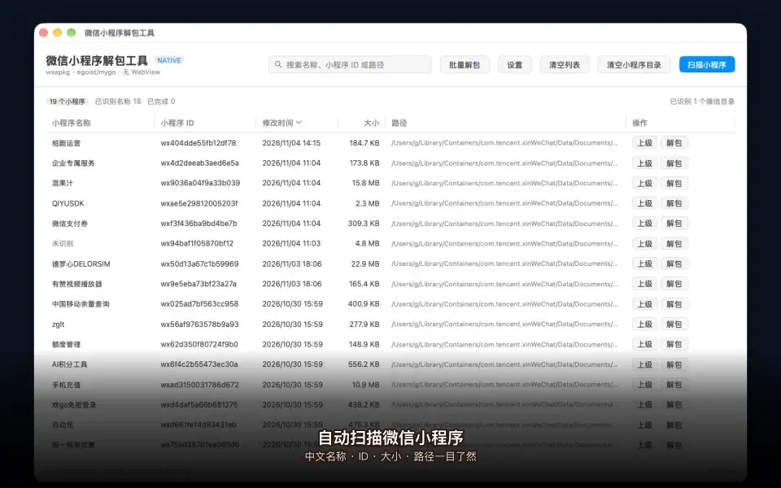
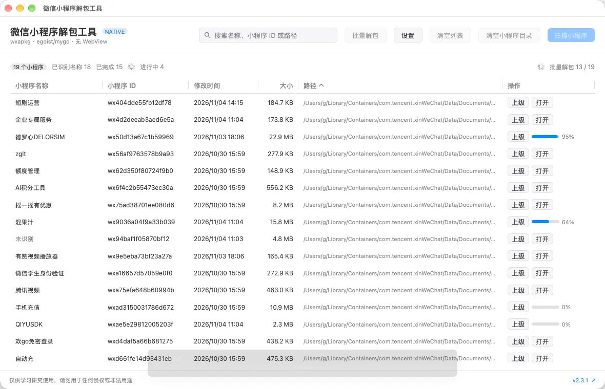
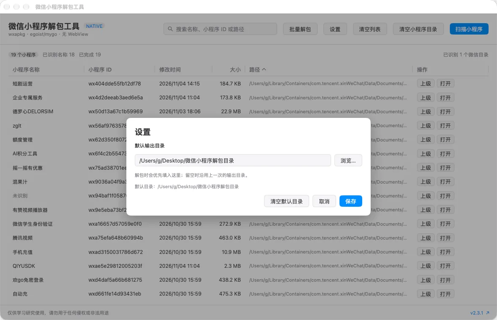

# 微信小程序解包工具

> **免责声明**：此工具仅限于学习和研究软件内含的设计思想和原理，用户承担因使用此工具而导致的所有法律和相关责任。作者不承担任何法律责任。

微信小程序解包工具是一款纯原生的微信小程序（`.wxapkg`）解包与代码美化工具。它会自动定位微信缓存目录，扫描本机小程序，支持单个或批量解包，并把 JavaScript、HTML、JSON 还原成可读源码。窗口、表格、弹窗和文件选择器全部由 Go 与 [egoist/mygo](https://github.com/egoist/mygo) 原生绘制，不使用 Wails、HTML、JavaScript 或 WebView。



动图演示：自动扫描 → 批量解包 → 默认输出目录 → OXC 美化。若页面未播放动画，可[查看原图](assets/demo.webp)。

## 为什么用它

- **不用命令行**：打开就能看到小程序名称、ID、大小、修改时间和缓存路径。
- **单个和批量都行**：选中一个解包，或一键处理整个列表；批量任务并行执行，进度实时显示。
- **开箱即用的代码美化**：内置 OXC Oxfmt Rust 引擎，JS、HTML、JSON 默认勾选美化，不需要安装 Node.js。
- **结果好找**：默认输出到 `桌面/微信小程序解包目录/`，目录名带小程序名称、ID 和修改时间。
- **纯原生**：MyGo Native 界面，无 WebView、无 Chromium、无前端构建步骤。

## 核心功能

### 自动扫描与列表

- 自动识别微信 4.x 用户目录，同时兼容微信 4.0 和 3.x 的旧目录。
- 支持自动扫描、手动选择目录、粘贴路径、系统文件选择器，以及命令行传入路径。
- 列表展示中文名称、小程序 ID、修改时间、大小、缓存路径和解包状态。
- 支持按列排序、按名称或 ID 搜索，扫描和解包都在后台执行。
- 每行可打开缓存上级目录；解包完成后可直接打开输出目录。

### 单个解包

点击任意一行的“解包”即可配置本次任务：

- 自动使用小程序 ID 解密新版加密包。
- 可选择输出目录，并恢复小程序源码目录结构。
- 解密、HTML 美化、JS 美化、JSON 美化默认勾选，也可以按需关闭。
- 解包进度、完成状态和错误信息直接显示在列表中。

### 批量解包



点击顶部“批量解包”可以一次处理列表中的全部小程序：

- 最多同时解包 4 个小程序，并按并发数分配 Oxfmt 线程。
- 输出目录格式为 `小程序名称-小程序ID-修改时间`，例如 `中国移动余量查询-wx025ad7bf563cc958-20261030-155948`。
- 同名且同 ID 的旧结果会自动删除并替换，不会影响其他目录。
- 实时显示总进度、每个小程序的百分比和成功或失败状态。
- 批量结束后汇总成功和失败数量，失败项可以在列表中重试。

### 输出目录与设置



- 默认输出目录为 `桌面/微信小程序解包目录/`。
- 可以在设置中修改默认目录，也可以随时恢复默认值。
- 单个解包时优先使用默认目录；留空时沿用上一次的输出目录。
- 设置会保存在本机，下次启动继续生效。

### 中文名称识别

按包内元数据、包内导航标题、微信官方公开资料页、有赞公开店铺信息的顺序识别中文名称；没有可靠来源时显示“未识别”，不会伪造名称。小程序 ID 仍可正常用于解密和解包。

### 安全清理

“清空小程序目录”只删除微信 `packages` 根目录下名称严格匹配 `^wx[0-9a-f]{16}$` 的直接子目录，不会删除根目录、普通文件、聊天记录或账号数据；执行前会显示原生危险操作确认，默认按钮是“取消”。

## 输出示例

```text
桌面/微信小程序解包目录/
├── 中国移动余量查询-wx025ad7bf563cc958-20261030-155948/
│   ├── app-config.json
│   ├── app-service.js
│   ├── app.wxss
│   └── pages/
└── 德罗心DELORSIM-wx50d13a67c1b59969-20261103-180600/
    └── ...
```

## 使用流程

1. 打开应用，等待自动扫描微信小程序目录。
2. 在列表中搜索或排序，找到需要的小程序。
3. 点击“解包”处理单个小程序，或点击“批量解包”处理全部。
4. 在设置中确认默认输出目录；批量结果会按名称、ID 和修改时间分目录保存。
5. 完成后点击“打开”查看源码，或直接在 Finder 或资源管理器中浏览输出目录。

## 代码美化性能

JS/HTML/JSON 格式化已从旧版逐文件 Go 美化切换到 [OXC](https://oxc.rs/) 的 [`oxfmt`](https://github.com/oxc-project/oxc)。Oxfmt 是 Rust 原生二进制，支持多线程，不依赖 Node.js，也不使用 WebView。

本机同一份真实微信小程序包（22.9 MB、3938 个文件）实测：

| 模式 | 耗时 |
| --- | ---: |
| 仅解包，不美化 | 约 0.18–0.26 秒 |
| 解包 + Oxfmt 美化 | 约 0.59–1.10 秒 |

旧 Go 美化实现处理同一份输出超过 5 分钟仍未完成。批量解包还会在 Oxfmt 可用时最多并行处理 4 个小程序，并按任务数分配格式化线程。发布包内置 Oxfmt `0.76.0`；源码运行时如果找不到该二进制，会自动回退到旧 Go 美化实现，功能仍可用，但速度会明显较慢。

Oxfmt 使用 MIT 许可，许可全文见 [resources/oxfmt-LICENSE.txt](resources/oxfmt-LICENSE.txt)。

## 支持的系统与微信目录

已在 macOS 27.2、微信 4.2.0 上验证当前实际目录：

```text
~/Library/Containers/com.tencent.xinWeChat/Data/Documents/app_data/radium/users/<用户哈希>/applet/packages
```

同时支持：

| 版本 | macOS | Windows |
| --- | --- | --- |
| 微信 4.1.7+ | `.../radium/users/<hash>/applet/packages` | `%APPDATA%\Tencent\xwechat\radium\users\<hash>\applet\packages` |
| 微信 4.0 | `.../radium/Applet/packages` | `%APPDATA%\Tencent\xwechat\radium\Applet\packages` |
| 微信 3.x | `.../Data/.wxapplet/packages`、`Documents/WeChat Files/Applet` | `Documents\WeChat Files\Applet` |

程序会在有限深度内查找 `applet/packages` 和 `.wxapplet/packages`，并跳过 `web`、`cache`、`xworker`、`ilink` 等无关的大目录。旧版本与未来小范围目录调整不会被单一硬编码路径限制。

## 名称识别与清理

名称按以下顺序识别：

1. 读取包内 `plugin.json`、`app-config.json` 等元数据中的明确应用名称。
2. 使用包内全局导航标题，但过滤“首页”“商品详情”“微信支付”等通用页面标题。
3. 使用小程序 ID 查询微信官方公开资料页，读取小程序或插件昵称。当前实测可识别“德罗心DELORSIM”“腾讯视频”“中国移动余量查询”等名称。
4. 官方资料页没有结果时，对有赞店铺小程序使用包内公开 `kdtId` 查询公开店铺名称。
5. 没有可靠来源时显示“未识别”，不会伪造名称；小程序 ID 仍可正常用于解密和解包。

公开名称查询只向微信官方资料页发送公开 AppID，或在备用流程中发送有赞公开商家 ID；不读取或上传微信 Cookie、账号信息、聊天记录、本机路径或解密密钥。成功结果会缓存在本机，后续扫描优先使用缓存；离线、未公开或资料页没有昵称时会回退到包内名称或“未识别”。

“清空小程序目录”只会删除已识别 `applet/packages`（或 `.wxapplet/packages`）根目录下、名称严格匹配 `^wx[0-9a-f]{16}$` 的直接子目录。它不会删除 `packages` 根目录、普通文件、其他目录、聊天记录或账号数据，并且默认按钮是“取消”。建议先退出微信再清理；下次打开小程序时微信会重新下载。

### macOS 完全磁盘访问权限

macOS 会保护其他应用的沙盒数据。未授权时，系统会阻止程序读取微信容器，即使目录确实存在。首次自动扫描时：

1. 点击程序提示中的“打开系统设置”。
2. 在“系统设置 → 隐私与安全性 → 完全磁盘访问权限”中启用“微信小程序解包工具”。
3. 退出并重新打开程序，然后点击“重新检测”。

如果开关已经是打开的，程序仍提示需要权限，说明系统里保留的是旧构建的授权记录。点击程序里的“清除旧授权”，再在系统设置中点击 `+` 添加当前 `微信小程序解包工具.app`，重启程序即可。也可以在终端手动清除：

```bash
tccutil reset SystemPolicyAllFiles com.wux1an.wxapkg.native
```

原生版使用独立 Bundle ID `com.wux1an.wxapkg.native`，不会与旧 Wails 版 `com.wux1an.wxapkg` 混用授权。若你仍安装旧版，建议先退出或移除旧版，避免误把权限授予旧应用。

从网络下载的未签名版本如果被 Gatekeeper 拦截，可在 Finder 中右键应用并选择“打开”。本项目生成的 macOS 包使用固定的代码要求，重新授权一次后，后续未签名构建不会再因为代码哈希变化而丢失权限。

## 安装

从 [Releases](https://github.com/gakaki/wxapkg/releases/latest) 下载：

- macOS：`.dmg`
- Windows：`x64` 或 `ARM64` 安装包
- 每个安装包旁的 `SHA256SUMS-*.txt` 可用于校验

## 自行编译

要求 Go 1.27.3 或兼容版本。项目没有前端依赖，不需要 Node.js、Bun、npm、Wails/CGO，也不需要 WebView SDK。

```bash
go tool mygo dev
./scripts/build-macos.sh
```

`scripts/build-macos.sh` 会自动下载并校验 Oxfmt，然后生成通用 macOS `.app` 和 `.dmg`，并写入稳定的完全磁盘访问代码要求。Windows 安装包：

```bash
./scripts/fetch-oxfmt.sh windows amd64
go tool mygo build -platform windows/amd64
```

构建 Windows ARM64 安装包时把两条命令中的 `amd64` 都改为 `arm64`。下载缓存位于 `~/.local/share/codex-tools/cache/wxapkg/oxfmt/`，每个文件都会按固定 SHA-256 校验。网络较慢时可设置 `WXAPKG_USE_PROXY=1` 使用本机 `127.0.0.1:7890` 代理，或通过 `WXAPKG_PROXY` 指定其他代理。

产物位于 `build/`：

- `build/darwin-universal/`：通用 macOS `.app` 与 `.dmg`
- `build/windows-amd64/`：Windows x64 安装包
- `build/windows-arm64/`：Windows ARM64 安装包

Windows 安装包使用 NSIS。在 Linux 上交叉构建时先安装 `nsis`；在 macOS 上构建 Windows 安装包时同样需要 `makensis`。

也可以直接从命令行打开路径：

```bash
open -a "微信小程序解包工具" --args "/path/to/packages"
```

## 验证

```bash
go test ./...
go vet ./...
go tool mygo vet .
./scripts/build-macos.sh
```

本机真实微信包测试（不会写入微信缓存目录）：

```bash
WXAPKG_LIVE_TEST=1 go test ./wechat -run TestLiveWeChatUnpack -v

WXAPKG_LIVE_TEST=1 \
WXAPKG_OXFMT="$PWD/resources/darwin-arm64/oxfmt" \
go test ./wechat -run TestLiveUnpackPerformance -v -count=1 -timeout=5m
```

## 技术说明

- 窗口使用 `mygo.WindowOptions.Content` 和 `ui.View` 构建。
- 所有交互均由 `github.com/egoist/mygo/ui` 原生组件完成。
- 全局禁用 WebView、Chromium、WebKit、WebView2、GTK WebKit 和前端构建步骤。
- 解包由 Go 完成；JS/HTML/JSON 格式化调用随应用打包的 Oxfmt Rust 二进制，并行度和格式化线程数受控。
- 项目规则见 [AGENTS.md](AGENTS.md)。

## 来源与灵感

- 本项目的产品方向、微信小程序扫描与解包思路来自 [wux1an/wxapkg](https://github.com/wux1an/wxapkg)。感谢原作者和贡献者提供的基础与灵感。
- 当前版本在此基础上完全使用 [egoist/mygo](https://github.com/egoist/mygo) 的 MyGo Native UI 重写：窗口、表格、弹窗、文件选择器和全部交互均由 Go 原生组件实现，不使用 Wails、WebView、HTML、CSS 或 JavaScript 前端。
- 代码美化的高性能实现来自 [OXC / Oxfmt](https://oxc.rs/docs/guide/usage/formatter)，感谢 Oxc 项目及贡献者。
- 微信小程序解密、解包格式和原理还参考了下方“参考”中列出的公开项目与文章。

## 参考

- 微信小程序插件公开资料页：<https://mp.weixin.qq.com/wxopen/pluginbasicprofile>
- 小程序解密：<https://github.com/BlackTrace/pc_wxapkg_decrypt>
- 小程序解包：<https://gist.github.com/Integ/bcac5c21de5ea35b63b3db2c725f07ad>
- 原理介绍：<https://misakikata.github.io/2021/03/%E5%BE%AE%E4%BF%A1%E5%B0%8F%E7%A8%8B%E5%BA%8F%E8%A7%A3%E5%8C%85/>
